# Architecture & dependencies

The 13 `src/` projects form four cooperating layers. Edges below are the actual
`ProjectReference`s from each csproj — several are intentionally *not* what the layer names suggest.

## Dependency graph

```mermaid
graph TD
  subgraph contracts [Contracts]
    Data[Ballware.Shared.Data]
    Api[Ballware.Shared.Api]
    Authorization[Ballware.Shared.Authorization]
    Mcp[Ballware.Shared.Mcp]
  end

  subgraph engines [Engines & adapters]
    DataEf[Ballware.Shared.Data.Ef]
    Jint[Ballware.Shared.Authorization.Jint]
    McpAuth[Ballware.Shared.Mcp.Authorization]
  end

  subgraph transports [Transports & hosts]
    ApiEndpoints[Ballware.Shared.Api.Endpoints]
    ApiJobs[Ballware.Shared.Api.Jobs]
    McpEndpoints[Ballware.Shared.Mcp.Endpoints]
    Auth[Ballware.Shared.Authentication]
    WebSession[Ballware.Shared.Web.Session]
    WebOidc[Ballware.Shared.Web.Oidc]
  end

  DataEf --> Data
  Jint --> Authorization
  ApiEndpoints --> Api
  ApiEndpoints --> Authorization
  ApiEndpoints --> Data
  ApiJobs --> Api
  ApiJobs --> Authorization
  ApiJobs --> Data
  McpEndpoints --> Mcp
  McpAuth --> Authorization
  WebOidc --> WebSession
```

Notable verified deviations:

- **`Ballware.Shared.Mcp.Authorization` does not reference `Ballware.Shared.Mcp`.** It only needs the
  delegate shape of `Tool.IsAuthorizedAsync` (evidence:
  `src/Ballware.Shared.Mcp.Authorization/Ballware.Shared.Mcp.Authorization.csproj` has a single
  `ProjectReference` to `Ballware.Shared.Authorization`;
  `src/Ballware.Shared.Mcp.Authorization/McpAuthorizationHandlerFactory.cs` returns
  `Func<IServiceProvider, ClaimsPrincipal, Task<bool>>` without importing the Mcp namespace).
- **`Api.Endpoints` and `Api.Jobs` are siblings**, both referencing `Api` + `Authorization` + `Data`;
  neither references the other. They are joined only at runtime by the host and the Quartz
  `JobDataMap` (see [editing-api-and-import-jobs.md](editing-api-and-import-jobs.md)).
- **`Ballware.Shared.Authentication` is standalone** — no project dependencies at all; it plugs into
  hosts through `JwtBearerEvents`.
- Contract packages `Data`, `Api`, `Authorization`, `Mcp` have no `ProjectReference` and (except
  small `Microsoft.Extensions.*`/hosting abstractions in `Authorization` and `Mcp`) no package
  dependencies.

## Layers

| Layer | Packages | Role |
| --- | --- | --- |
| Contracts | [Data](../packages/ballware-shared-data.md), [Api](../packages/ballware-shared-api.md), [Authorization](../packages/ballware-shared-authorization.md), [Mcp](../packages/ballware-shared-mcp.md) | Plain interfaces + DTOs; nothing to configure |
| Engines/adapters | [Data.Ef](../packages/ballware-shared-data-ef.md), [Authorization.Jint](../packages/ballware-shared-authorization-jint.md), [Mcp.Authorization](../packages/ballware-shared-mcp-authorization.md) | Implement contract seams |
| Transports | [Api.Endpoints](../packages/ballware-shared-api-endpoints.md), [Api.Jobs](../packages/ballware-shared-api-jobs.md), [Mcp.Endpoints](../packages/ballware-shared-mcp-endpoints.md) | Minimal APIs, Quartz jobs, MCP HTTP |
| Web/auth plumbing | [Authentication](../packages/ballware-shared-authentication.md), [Web.Session](../packages/ballware-shared-web-session.md), [Web.Oidc](../packages/ballware-shared-web-oidc.md) | Bearer path (Authentication) and cookie path (Web.Session/Web.Oidc); see [web-authentication-and-sessions.md](web-authentication-and-sessions.md) |

## Cross-cutting conventions

- **Tenancy by convention.** Every repository method, endpoint handler, job context, storage and
  export operation carries `Guid tenantId` explicitly (evidence: `ITenantableRepository`
  (`src/Ballware.Shared.Data/Repository/ITenantableRepository.cs`), `IFileStorageProvider`
  (`src/Ballware.Shared.Api/IFileStorageProvider.cs`), `IJobMetadataProvider`
  (`src/Ballware.Shared.Api/IJobMetadataProvider.cs`)). The current tenant is extracted from claims
  via `IPrincipalUtils` (`src/Ballware.Shared.Authorization/IPrincipalUtils.cs`).
- **Dual identity.** Persistables have `long? Id` (database) + `Guid Uuid` (public)
  (`src/Ballware.Shared.Data/Persistables/IEntity.cs`); public DTOs expose `Guid Id`
  (`src/Ballware.Shared.Data/Public/IEditable.cs`), mapped onto `Uuid` by Mapster in
  `BaseRepository.SaveAsync`/`ByIdAsync` (`src/Ballware.Shared.Data.Ef/Repository/BaseRepository.cs`).
- **Auth context travels as data.** No ambient user injection into repositories: identity/claims
  move through calls as `string identifier` + `IDictionary<string, object> claims`
  (`src/Ballware.Shared.Data/Repository/IRepository.cs`), with `Guid? userId` on mutations; the
  endpoints bindings materialize them from the `ClaimsPrincipal` per request.
- **Auth decisions as data too.** Rights rules are stored script snippets on tenant/entity metadata
  interfaces (`src/Ballware.Shared.Authorization/ITenantAuthorizationMetadata.cs`,
  `IEntityAuthorizationMetadata.cs`) resolved per call through `IAuthorizationMetadataProvider` —
  authorization configuration lives in the data layer, not in code attributes.
- **Composition over registration.** Packages expose small `Add*`/`Use*`/`Map*` extensions; hosts
  pick the pieces they need (see [usage/host-composition.md](../usage/host-composition.md)).
